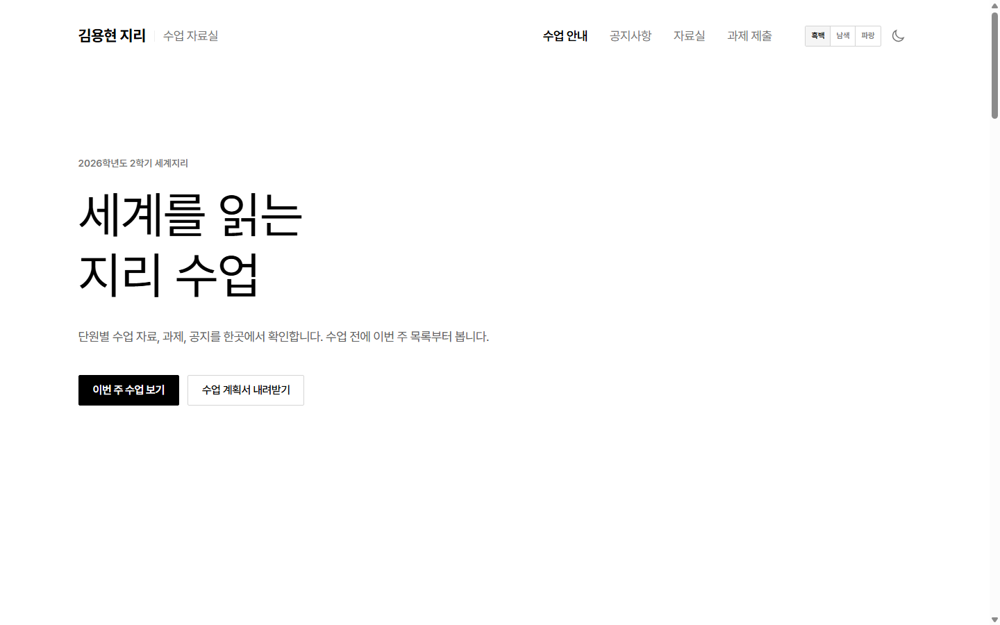
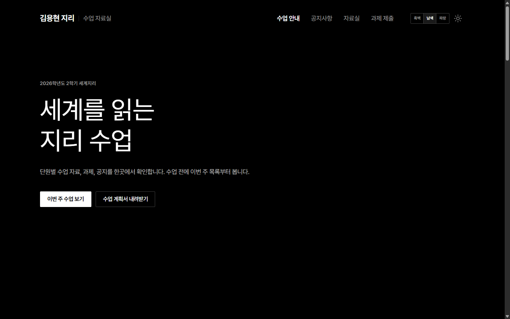
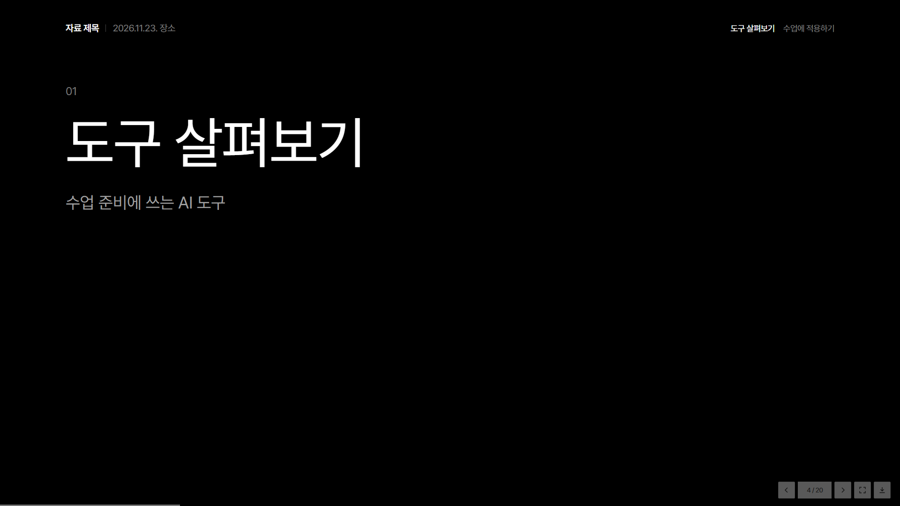
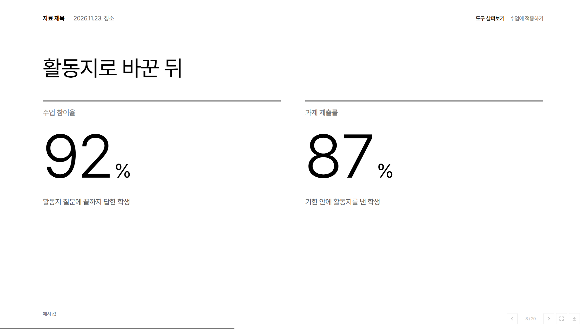
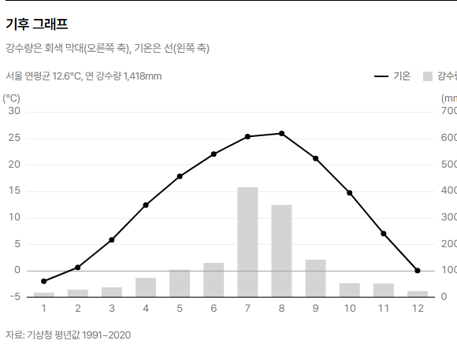
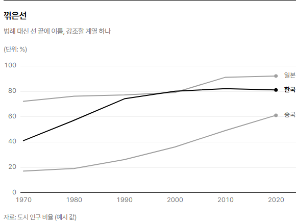
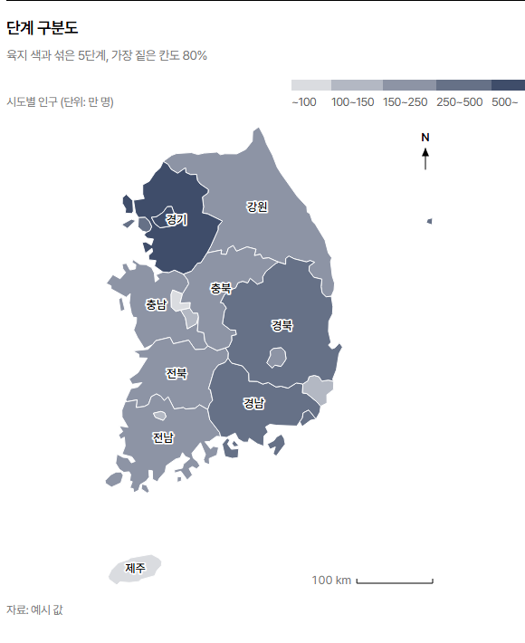
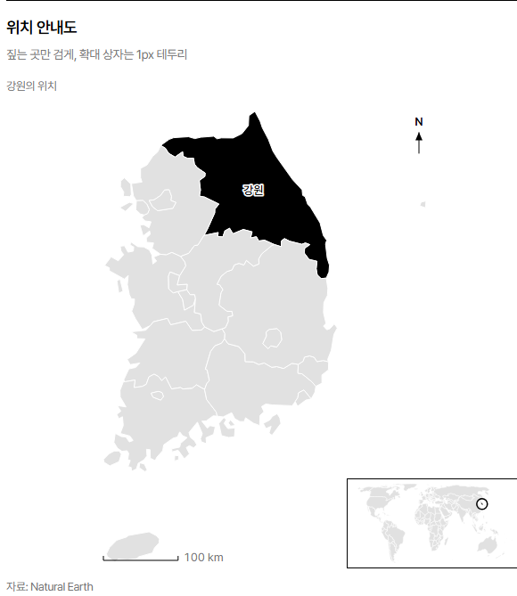

# 모노 디자인 (mono-design)

검정, 흰색, 회색 일곱 단계로 만드는 에디토리얼 디자인 스킬입니다. 제목은 크고 가늘게, 모서리는 직각, 구조는 상자 대신 가는 줄로 나눕니다. 웹페이지와 웹 도구, 1920x1080 HTML 발표자료에 같은 디자인을 입히고, 그래프와 지도도 같은 모양으로 그립니다.

Claude Code와 Codex에서 같은 스킬 파일을 그대로 씁니다. "모노 디자인으로 연수 발표자료 만들어 줘", "이 페이지에 모노 디자인 적용해 줘"처럼 말하면 됩니다. 확실하게 쓰게 하려면 요청 앞에 스킬 이름을 붙이세요. Claude Code는 `/mono-design`, Codex는 `$mono-design`입니다.



## 특징

- **흑백 중심**: 검정, 흰색, 회색 7단계. 강조색은 내용 안 한두 군데에만 씁니다.
- **가늘고 큰 제목**: 큰 제목은 굵기 200~400, 굵은 글자는 작은 이름표에만.
- **직각과 가는 줄**: 모서리 0(버튼만 2px), 그림자와 그라데이션 없음. 목록 위 검은 줄, 행 사이 연한 줄.
- **세 가지 테마**: `mono`(강조색 없음), `navy`(남색), `blue`(파랑). `<html data-tone="navy">` 한 줄로 바꿉니다.
- **라이트와 다크 모드**: 기기 설정을 따르고 버튼으로도 바꿉니다. 다크 모드 강조색은 대비 4.5:1 이상으로 계산했습니다.
- **휴대폰 대응**: 옆으로 밀리는 메뉴 줄, 햄버거 서랍, 가로 넘침 없음, 누르는 곳 44px.
- **발표자료 엔진**: 장 이름으로 위쪽 목차 자동 생성, 하나씩 보이기, 발표 리모컨 키, 전체 화면, P 키로 PDF 저장(장마다 한 쪽).
- **그래프 7종, 지도 4종**: 세로와 가로 막대, 꺾은선, 산점도, 100% 띠, 기후 그래프, 인구 피라미드, 단계 구분도, 도형 표현도, 유선도, 위치 안내도. 라이브러리 없는 `mono-viz.js` 하나로 그리고, 테마와 다크 모드를 저절로 따릅니다. 한국 시도와 세계 국가 경계(Natural Earth) 포함.
- **잉크 아끼는 인쇄**: 인쇄와 PDF에서는 검은 상자와 버튼이 회색 면으로, 검은 푸터와 장 구분은 흰 바탕으로 바뀝니다. 다크 모드로 보다가 인쇄해도 흰 종이로 나옵니다.

| 다크 모드 (navy) | 휴대폰 (blue) | 휴대폰 다크 (mono) |
|---|---|---|
|  |  |  |

### 발표자료

| 표지 | 장 구분 |
|---|---|
|  |  |
| **큰 숫자** | **핵심 한 줄** |
|  |  |

### 그래프와 지도

| 기후 그래프 | 꺾은선 |
|---|---|
|  |  |
| **단계 구분도 (navy)** | **위치 안내도** |
|  |  |

## 설치

### Claude Code

```
/plugin marketplace add yhk1m/mono-design
/plugin install mono-design@mono-design
```

새 버전은 `/plugin marketplace update mono-design`을 입력한 뒤 `/plugin update mono-design@mono-design`으로 받습니다.

### Codex

터미널에서 아래 두 줄을 차례로 입력합니다.

```
codex plugin marketplace add yhk1m/mono-design
codex plugin add mono-design@mono-design
```

새 버전은 `codex plugin marketplace upgrade mono-design`으로 받습니다.

### 폴더를 직접 복사하기

플러그인을 쓰지 않으려면 `skills/mono-design` 폴더를 통째로 복사합니다.

| 도구 | 모든 프로젝트에서 쓰기 | 한 프로젝트에서만 쓰기 |
|---|---|---|
| Claude Code | `~/.claude/skills/mono-design` | `프로젝트/.claude/skills/mono-design` |
| Codex | `~/.agents/skills/mono-design` | `프로젝트/.agents/skills/mono-design` |

Windows에서 `~`는 `C:\Users\<사용자이름>`입니다.

## 들어 있는 것

```
.claude-plugin/               Claude Code 플러그인 정보
.codex-plugin/                Codex 플러그인 정보
.agents/plugins/              Codex 마켓플레이스 정보
skills/mono-design/
  SKILL.md                     쓰는 법과 핵심 규칙
  references/tokens.md         색, 글자, 간격, 모양, 움직임 값
  references/web.md            웹 부품 규격과 예시 HTML
  references/slides.md         발표자료 엔진과 부품 목록
  references/charts.md         그래프 일곱 가지와 규칙
  references/maps.md           지도 네 가지, 경계 자료, 단계 색
  references/checklist.md      완성 전 점검표
  assets/mono.css              토큰과 웹 부품
  assets/web-template.html     예시 웹페이지 (단일 파일)
  assets/slides-template.html  예시 발표자료 22장 (단일 파일)
  assets/mono-viz.js           그래프와 지도 그리기 (라이브러리 없음)
  assets/viz-template.html     그래프와 지도 예시 (단일 파일)
  assets/geo/                  한국 시도, 세계 국가 경계
```

## 개발

```
node scripts/build-template.mjs   # mono.css, mono-viz.js를 고친 뒤 템플릿 다시 만들기
node scripts/verify.mjs all       # 헤드리스 Chrome으로 넘침, 대비, 오류, 넘기기, 인쇄 검은 면 검사
```

## 라이선스

MIT. 지도 경계는 Natural Earth(퍼블릭 도메인)입니다.
